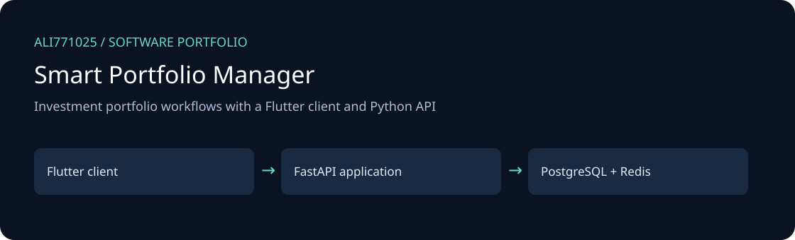
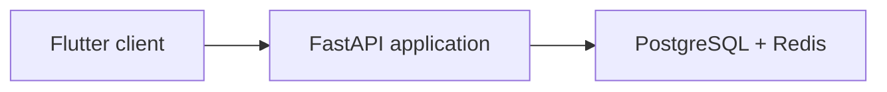

# Smart Portfolio Manager

Investment portfolio workflows with a Flutter client and Python API

[راهنمای فارسی](docs/README.fa.md) · [Discuss a project](https://github.com/Ali771025)

## What this project demonstrates

- Portfolio and transaction management with weighted-average-cost and realized profit/loss logic.
- Market-data ingestion, import parsers and background processing modules.
- Persian interface foundations, client state management and chart views.

**Technology:** Flutter, Dart, FastAPI, PostgreSQL, Redis, SQLAlchemy.

## Architecture

The illustration describes source boundaries; it is not a product screenshot.

## Explore and set up

Backend: Python dependencies are in `requirements.txt`; install them in a virtual environment, copy `.env.example` to `.env`, configure local PostgreSQL and run `uvicorn app.main:app --reload`. Review `alembic/` before applying migrations. Client: restore packages using `flutter pub get`, then configure the API endpoint in the client. No setup command was run here.

## Portfolio scope and limitations

Font binaries were omitted for size; `pubspec.yaml` lists the required asset filenames. Restore appropriately licensed fonts or adjust those declarations before running Flutter. Market services require their own availability/configuration; financial accuracy is not newly certified.

This edition contains selected source only. Private data, customer documents, databases, deployment secrets, old Git history, generated outputs, dependency caches and model weights are excluded. No new tests, builds, or live integrations were executed for this publication; runtime behavior and production readiness are not newly validated.

## Work with me

Need a similar workflow, an integration, or modernization of an existing application? [Contact Ali on GitHub](https://github.com/Ali771025) with your business process, target platform and delivery constraints. This source demonstrates relevant implementation areas; any proposed delivery needs its own agreed scope and acceptance criteria.

## Dependencies and attribution

Existing source headers and bundled notices remain applicable. Third-party components retain their own licenses; restore dependencies from the manifests. No additional license grant is implied by this portfolio publication.
